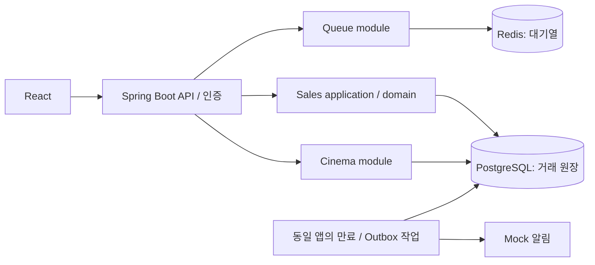
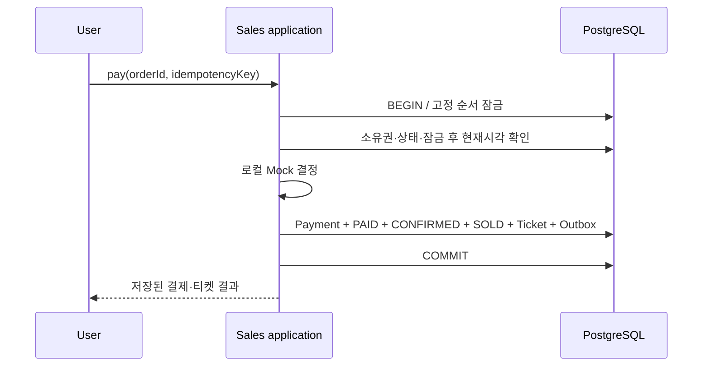

# 시스템 아키텍처 v2.0 — DB-first 모듈러 모놀리스

## 1. 결정과 경계

PostgreSQL을 재고·선점·주문·결제·티켓의 유일한 진실원본으로 사용한다. Redis 재고 차감과 DB write-behind는 제거한다. DB Outbox가 Redis와 DB를 하나의 원자적 거래로 만든다고 설명하지 않는다.

Spring Boot 한 프로세스 안에서 api / sales / cinema / queue / notification / infrastructure 패키지를 나눈다. 논리적 분리는 별도 배포를 의미하지 않는다. 계층과 Ports & Adapters는 코드 의존성 규칙이며 CQRS·Saga·분산 락은 필수 구성으로 채택하지 않는다.



판매 코어는 cinema·Spring MVC·Redis API에 의존하지 않는다. Application이 트랜잭션과 권한·유스케이스를 조정하고 Domain이 상태 전이 규칙을 가진다. JPA 엔티티와 매핑을 분리해 외부 의존성이 코어로 유입되지 않게 한다.

## 2. 포트와 책임

```java
interface StockRepositoryPort {
    StockUnit lockById(long stockUnitId);
}
interface HoldRepositoryPort {
    Hold lockById(long holdId);
    void save(Hold hold);
}
interface PaymentPort {
    MockDecision decide(MockPaymentCommand command);
}
interface QueuePort {
    Admission requireAdmission(long eventId, long userId, String token);
}
interface DomainDescriptorPort {
    StockDescription describe(long stockUnitId);
}
```

개념 계약이며 아직 컴파일 가능한 구현은 아니다. PaymentPort의 v2 계약은 **외부 I/O·외부 금전 효과 없는 결정적 Mock**으로 제한한다. 실제 PG 어댑터를 그대로 끼워 넣을 수 있다고 주장하지 않는다. 실제 PG 도입 시 별도 결제 시도·UNKNOWN·조회·환불 보상 설계가 필요하다.

## 3. 잠금·시간·트랜잭션 규칙

- 기본 격리 수준 READ COMMITTED + 명시적 행 잠금.
- 모든 재고 변경 경로는 `SalesEvent 공유 잠금 → StockUnit → Hold → Order` 순서. 해당 객체가 없는 단계는 생략한다. ID 탐색을 위한 사전 읽기는 가능하지만 변경 판단은 잠금 후 다시 한다.
- 판매 설정을 변경하는 관리자 경로는 SalesEvent 배타 잠금. 오픈 이후 좌석 정의·가격 변경을 허용하지 않는다. 공유 잠금은 서로 다른 좌석 선점을 직렬화하지 않는다.
- 미래의 다좌석 기능은 잠금 ID 오름차순 및 전부 성공/전부 실패 설계가 먼저 필요하다.
- 만료 판정은 **잠금을 확보한 후 DB clock_timestamp()**로 읽는다. 트랜잭션 시작 시각이 고정되는 now()를 잠금 대기 후 만료 판정에 사용하지 않는다.
- 네트워크 호출 중 DB 잠금을 유지하지 않는다. Mock은 로컬 순수 계산이므로 v2 결제 트랜잭션에서만 예외적으로 호출 가능하다.
- 응답은 커밋 성공 후 반환한다. 타임아웃은 실패 확정이 아니므로 멱등키 재시도·상태 조회로 확인한다.
- 제약 위반·잠금 타임아웃·데드락은 전체 롤백. 제한된 재시도 정책과 최종 응답을 테스트한다.

## 4. 좌석 선점

1. 사용자 인증, event/user/epoch/유효기간에 결합된 입장권 검증. Redis 장애 시 신규 선점은 503.
2. DB 트랜잭션 시작. 멱등 요청을 등록·잠그고 기존 완료 응답이면 재사용한다.
3. 이벤트 공유 잠금, 좌석 잠금. 이벤트 소속·OPEN·판매시간·AVAILABLE 확인.
4. HELD 좌석에 이미 만료된 Hold가 있으면 같은 잠금 규칙으로 만료 전이 후 재판정할 수 있다. 미만료 Hold는 409.
5. StockUnit HELD, Hold ACTIVE 생성, expires_at=잠금 후 DB 시각+300초.
6. 응답 기록과 함께 커밋. 캐시 값은 판매 판정에 사용하지 않는다.

## 5. 주문·Mock 결제·발권

### 주문 생성

입장권은 다시 요구하지 않는다. 본인 Hold의 stock/event ID를 찾고 정해진 잠금 순서로 재조회한다. ACTIVE·미만료·소유권·회차를 확인하고 서버 가격으로 PENDING Order를 생성한다. Hold 하나에 주문 하나만 허용한다. 주문 생성으로 만료 시각을 연장하지 않는다.

### 결제

인증·멱등키 검증 후 이벤트/StockUnit/Hold/Order 잠금을 획득한다. 이미 PAID라면 저장된 결과를 반환한다. PENDING·본인 소유·ACTIVE·미만료인지 확인한 후 로컬 Mock 결정을 계산한다.

- 승인: Hold CONFIRMED, StockUnit SOLD, Order PAID, Payment APPROVED, Ticket ACTIVE 생성, PaymentConfirmed Outbox 삽입을 **동일 DB 트랜잭션**에서 수행한다.
- 거절: Payment DECLINED, Order FAILED, Hold RELEASED, StockUnit AVAILABLE을 동일 트랜잭션에서 처리한다.
- 이미 만료: Hold EXPIRED, Order EXPIRED, StockUnit AVAILABLE을 커밋하고 만료 응답을 반환한다. 예외를 던져 정리까지 롤백하지 않도록 트랜잭션 결과와 HTTP 오류 매핑을 분리한다.

Mock 결정은 주문 ID와 테스트 시나리오에 대해 결정적이다. 실패 지연·프로세스 종료는 별도 테스트 훅으로 주입하며 외부 PG 거래를 흉내 낸다고 주장하지 않는다.



## 6. 만료·해제

스케줄러는 1초 간격으로 `status='ACTIVE' AND expires_at <= clock_timestamp()`의 후보 ID만 제한된 배치로 조회한다. 후보 조회에서 Hold를 먼저 잠그지 않는다. 각 후보는 별도 트랜잭션으로 고정 순서 잠금을 획득하고 상태·시간을 재검증한다.

- ACTIVE이고 만료되었을 때만 EXPIRED로 전이하고 좌석 AVAILABLE, 연결된 PENDING Order EXPIRED 처리.
- 사용자 해제는 본인 ACTIVE Hold만 RELEASED로 전이하며 PENDING Order CANCELLED 처리.
- CONFIRMED/EXPIRED/RELEASED에 대한 반복 해제는 추가 복원을 하지 않는다.
- **holdId와 현재 소유 관계**를 기준으로 복원한다. `restore(stockUnitId)` 같은 무조건 복원 API는 만들지 않는다.
- 결제와 만료가 경쟁하면 같은 좌석 잠금에서 직렬화된다. 만료 시각 이전 승인 판정이 먼저 이기면 확정, 그 외에는 만료다. 요청 접수시각만으로 결제 권리를 보장하지 않는다.
- 프로세스 재시작 후 DB 후보를 다시 찾아 누락 없이 수렴한다. 처리 지연은 측정하고 영구 방치를 허용하지 않는다.

## 7. Outbox·알림

발권·재고 복원은 커밋 경로에서 완료한다. Outbox는 알림 등 거래 성공 이후의 부수 효과에만 사용한다.

동일 앱의 배치가 이벤트를 lease로 점유하고 DB 잠금 밖에서 처리한다. 실패·lease 만료 시 재시도한다. 전달은 at-least-once이며 소비자는 eventId별 멱등 처리를 수행한다. 외부 전송과 DB 완료 표시 사이의 장애에서 일반적인 exactly-once 전송을 약속하지 않는다. 재시도 횟수·next_attempt_at·last_error·처리 지연을 기록한다.

## 8. 대기열

- 사용자당 이벤트별 대기 항목 하나. 원자적 Redis 스크립트 안에서 중복 검사·INCR 순번·ZADD를 처리한다. 동일 시각 대신 증가 순번으로 접수 순서를 정의한다.
- 입장 발급은 가장 낮은 유효 순번부터 원자적으로 제거하고 입장 lease를 등록한다. 입장 허용 속도와 active lease 상한을 함께 제한한다.
- 토큰은 event/user/epoch/nonce/만료시각에 결합하고 서버 저장 상태와 대조한다. JWT 로그인 토큰과 별개다. 유효 기간 중 복수 선점 시도를 허용하되 요청 제한과 사용자당 ACTIVE Hold 1개 제약으로 제한한다.
- 낮은 순번에 먼저 **권한을 부여**하는 것만 보장한다. 네트워크 수신·좌석 선점·구매 완료 순서는 보장하지 않는다.
- 판매 epoch는 DB에 영속 보관하고 Redis 재초기화 시 증가시켜 예전 입장권을 폐기한다. Redis 재시작·데이터 유실 감지 후 queue를 NOT_READY로 두고 관리 복구 전 입장을 중단한다. 복구는 입장 처리를 정지시킨 상태에서 수행한다.
- 대기 정보 유실 시 원래 순서를 복원한다고 주장하지 않는다. 새 epoch 재접수 정책을 사용자에게 안내한다. 장애 전후 FIFO는 보장 범위 밖이다.
- 기존 Hold 결제·해제·상태 조회는 대기열 장애와 독립적으로 DB에서 수행한다.

## 9. 장애 결과

| 장애 지점 | 기대 결과 |
|---|---|
| 선점 커밋 전 종료 | 전체 롤백, 좌석 AVAILABLE |
| 선점 커밋 후 응답 유실 | 같은 멱등키로 동일 Hold 조회 |
| 결제 커밋 전 종료 | PAID/SOLD/Ticket 일부만 남지 않음 |
| 결제 커밋 후 응답 유실 | 결제 재시도 시 기존 티켓 반환 |
| 결제·만료 경쟁 | CONFIRMED 또는 EXPIRED 중 하나만 승리 |
| 만료 작업 중단 | 재시작 후 ACTIVE 만료 후보 재처리 |
| Redis 중단 | 신규 대기·선점 차단, 기존 거래 완료 가능 |
| 알림 중복 | 거래 상태 불변, eventId 멱등 처리 |

성능·장애 시나리오는 04 문서의 테스트가 통과하기 전까지 보장 결과가 아니라 설계 계약이다.
