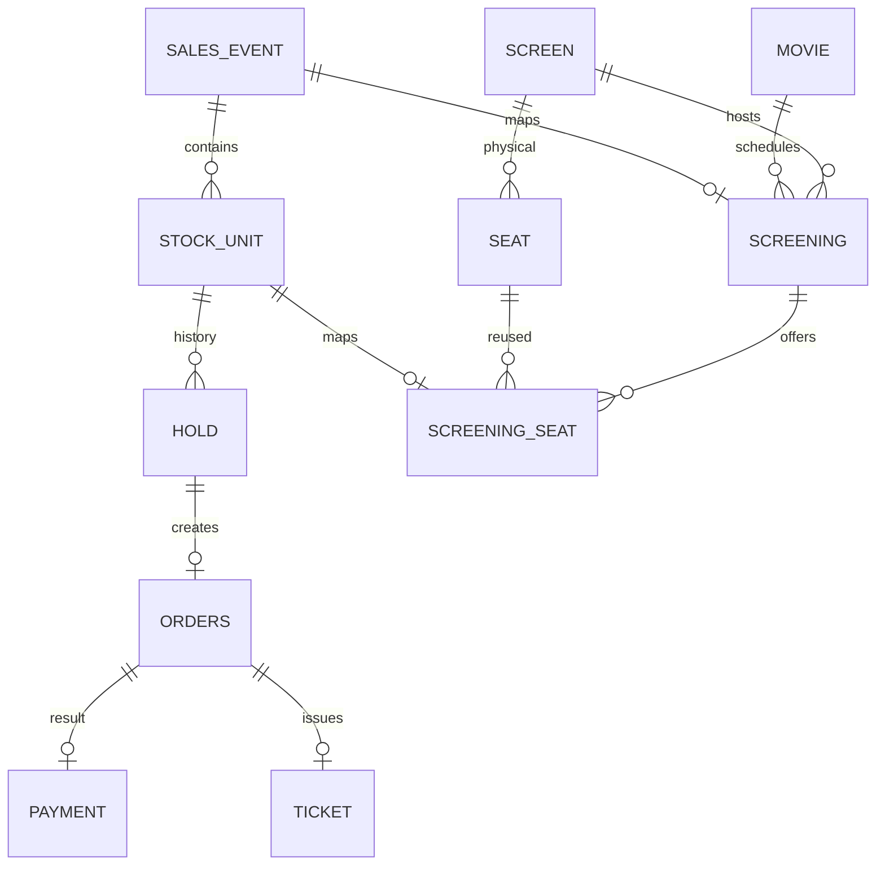

# 도메인 모델·데이터 계약 v2.0

## 1. 개념

- SalesEvent: 판매 이벤트. OPEN/CLOSED 등 판매 가능 여부를 가진다.
- StockUnit: **한 번에 한 명에게 판매하는 개별 단위**. 영화관에서는 특정 회차의 특정 좌석이다. SKU 수량 묶음이 아니다.
- Hold: StockUnit의 소유자·만료시각·선점 이력.
- Order: Hold 하나에서 만들어지는 주문. v2는 주문당 한 좌석이다.
- Payment: 주문당 최종 Mock 결제 결과 하나.
- Ticket: 결제와 같은 트랜잭션에서 생성하는 발권 결과.
- ScreeningSeat: 물리 좌석과 회차별 StockUnit의 매핑.

잔여 수량은 StockUnit 상태의 집계다. 별도 remaining_qty 쓰기 원장을 두지 않는다. 조회 캐시는 지연될 수 있으며 명령 판정에 사용하지 않는다. 일시적 잔여 0을 영구 SOLD_OUT 상태로 저장하지 않는다.



## 2. 상태와 불변식

| 대상 | 전이 |
|---|---|
| StockUnit | AVAILABLE → HELD → SOLD / HELD → AVAILABLE |
| Hold | ACTIVE → CONFIRMED / EXPIRED / RELEASED |
| Order | PENDING → PAID / FAILED / EXPIRED / CANCELLED |
| Payment | 최종 APPROVED / DECLINED 기록 |
| Ticket | ACTIVE만 사용; 환불 상태는 후속 설계 |

1. 한 StockUnit의 ACTIVE Hold는 최대 하나.
2. 사용자당 이벤트별 ACTIVE Hold 최대 하나. 만료시각만 지났다고 인덱스에서 제외되지 않으므로 신규 선점 전 기존 만료 Hold를 정리한다.
3. HELD이면 ACTIVE Hold가 하나, SOLD이면 CONFIRMED Hold와 PAID Order가 하나다.
4. 한 Hold에 Order 최대 하나. PAID Order는 APPROVED Payment와 Ticket을 가진다.
5. CONFIRMED Hold를 만료·해제로 되돌리지 않는다. 결제 완료 취소·재판매는 v2 범위 밖이다.
6. Order/Hold/StockUnit의 소유자·이벤트·좌석 관계가 일치해야 한다.

행 간 불변식은 UNIQUE 하나로 전부 보장되지 않는다. 모든 쓰기 경로가 02 문서의 잠금·트랜잭션 계약을 따라야 하며 DB 불변식 조회로 검증한다.

## 3. 핵심 SQL 계약

아래는 **핵심 제약 설계 예시**다. 사용자·영화관 전체 DDL이나 실행 완료된 Flyway 마이그레이션이 아니다. 구현 시 PK/FK·상태 CHECK·인덱스·트랜잭션을 통합 검증한다.

```sql
CREATE TABLE sales_event (
  id BIGINT GENERATED ALWAYS AS IDENTITY PRIMARY KEY,
  domain_type VARCHAR(20) NOT NULL,
  title VARCHAR(200) NOT NULL,
  status VARCHAR(20) NOT NULL CHECK (status IN ('SCHEDULED','OPEN','CLOSED')),
  open_at TIMESTAMPTZ NOT NULL,
  close_at TIMESTAMPTZ NOT NULL,
  queue_epoch BIGINT NOT NULL DEFAULT 1,
  CHECK (open_at < close_at)
);
CREATE TABLE stock_unit (
  id BIGINT GENERATED ALWAYS AS IDENTITY PRIMARY KEY,
  sales_event_id BIGINT NOT NULL REFERENCES sales_event(id),
  code VARCHAR(80) NOT NULL,
  price NUMERIC(12,2) NOT NULL CHECK (price >= 0),
  status VARCHAR(20) NOT NULL CHECK (status IN ('AVAILABLE','HELD','SOLD')),
  UNIQUE (sales_event_id, code),
  UNIQUE (id, sales_event_id)
);
CREATE TABLE hold (
  id BIGINT GENERATED ALWAYS AS IDENTITY PRIMARY KEY,
  stock_unit_id BIGINT NOT NULL,
  sales_event_id BIGINT NOT NULL,
  user_id BIGINT NOT NULL,
  status VARCHAR(20) NOT NULL CHECK (status IN ('ACTIVE','CONFIRMED','EXPIRED','RELEASED')),
  expires_at TIMESTAMPTZ NOT NULL,
  created_at TIMESTAMPTZ NOT NULL DEFAULT clock_timestamp(),
  FOREIGN KEY (stock_unit_id, sales_event_id)
    REFERENCES stock_unit(id, sales_event_id),
  CHECK (expires_at > created_at)
);
CREATE UNIQUE INDEX uq_hold_active_stock ON hold(stock_unit_id)
  WHERE status = 'ACTIVE';
CREATE UNIQUE INDEX uq_hold_active_user_event ON hold(user_id, sales_event_id)
  WHERE status = 'ACTIVE';
CREATE UNIQUE INDEX uq_hold_confirmed_stock ON hold(stock_unit_id)
  WHERE status = 'CONFIRMED';
CREATE INDEX ix_hold_expiry ON hold(expires_at, id) WHERE status = 'ACTIVE';

CREATE TABLE orders (
  id BIGINT GENERATED ALWAYS AS IDENTITY PRIMARY KEY,
  hold_id BIGINT NOT NULL UNIQUE REFERENCES hold(id),
  amount NUMERIC(12,2) NOT NULL CHECK (amount >= 0),
  status VARCHAR(20) NOT NULL CHECK (status IN ('PENDING','PAID','FAILED','EXPIRED','CANCELLED')),
  created_at TIMESTAMPTZ NOT NULL DEFAULT clock_timestamp()
);
CREATE TABLE payment (
  id BIGINT GENERATED ALWAYS AS IDENTITY PRIMARY KEY,
  order_id BIGINT NOT NULL UNIQUE REFERENCES orders(id),
  status VARCHAR(20) NOT NULL CHECK (status IN ('APPROVED','DECLINED')),
  provider VARCHAR(20) NOT NULL CHECK (provider = 'MOCK'),
  decided_at TIMESTAMPTZ NOT NULL
);
CREATE TABLE ticket (
  id BIGINT GENERATED ALWAYS AS IDENTITY PRIMARY KEY,
  order_id BIGINT NOT NULL UNIQUE REFERENCES orders(id),
  code UUID NOT NULL UNIQUE,
  issued_at TIMESTAMPTZ NOT NULL DEFAULT clock_timestamp()
);
```

Order의 사용자·이벤트·StockUnit은 Hold 관계에서 얻어 중복 불일치를 줄인다. 사용자 FK는 실제 app_user 테이블 도입 시 추가한다. v2에서 OrderLine은 제거한다. 여러 좌석 주문은 HoldGroup/OrderLine을 별도 설계한 후 도입한다.

### 영화관 매핑

- Seat: `(screen_id, row_label, col_no)` UNIQUE. 물리 좌석은 회차에 독립적이다.
- Screening: `sales_event_id` UNIQUE NOT NULL, movie_id, screen_id, start_at.
- ScreeningSeat: screening_id, seat_id, stock_unit_id. `(screening_id, seat_id)` UNIQUE, stock_unit_id UNIQUE.
- Seat가 Screening과 같은 Screen에 속하는지, StockUnit의 event가 Screening의 event인지 등록 트랜잭션에서 검증한다. 구현 마이그레이션에서는 screen_id/event_id를 포함한 복합 FK로 강화한다.
- 하나의 물리 좌석은 서로 다른 회차의 StockUnit 여러 개와 연결된다. `seat.stock_unit_id`는 두지 않는다.
- 상영 오픈 이전에 매핑·가격·재고 생성을 한 트랜잭션으로 끝내고 오픈 이후 수정 금지.

### 멱등 요청

`idempotency_request(user_id, operation, key, request_hash, response_status, response_body, created_at)`를 두며 `(user_id, operation, key)` UNIQUE. 인증된 사용자·작업 종류별 키다.

요청 기록 생성·잠금은 비즈니스 행 잠금 전에 수행한다. 중복 동시 요청은 기존 행의 완료를 기다린 뒤 저장 응답을 반환한다. 같은 키·다른 payload는 409. 성공 응답 저장과 거래 변경을 같은 트랜잭션으로 커밋하고, 롤백되면 둘 다 사라진다. 업무상 거절 응답을 저장할 때도 같은 규칙을 적용한다. v2는 자동 삭제하지 않아 실행 기간 동안 재시도를 보장한다. payload 해시에는 대상 ID와 Mock 시나리오 등 의미 있는 입력을 모두 포함한다.

사용자당 ACTIVE Hold UNIQUE 충돌은 다른 좌석을 먼저 잠근 두 요청 사이에서도 발생할 수 있다. 제약 충돌 시 전체 롤백한 뒤 별도 조회로 기존 Hold를 안내한다. 기존 Hold 정리는 다른 좌석 잠금을 잡기 전 별도 트랜잭션으로 수행하고, 최종 선점에서는 제약으로 다시 방어한다.

### Outbox

`outbox_event(id UUID PK, aggregate_id, type, payload JSONB, status, attempts, next_attempt_at, lease_until, last_error, created_at, processed_at)`.

소비자 측 `processed_event(consumer_name, event_id)` 복합 PK로 중복 효과를 제어한다. 이 테이블만으로 외부 알림의 exactly-once가 보장되는 것은 아니다.

## 4. REST API

| Method | Path | 계약 |
|---|---|---|
| GET | /api/events | 상영·판매 목록 |
| GET | /api/events/{eventId} | 상세·좌석 상태; 조회는 순간 스냅샷 |
| POST | /api/events/{eventId}/queue | 대기표 생성 또는 기존 표 반환 |
| GET | /api/events/{eventId}/queue/me | 본인 순번·입장권 상태 |
| POST | /api/events/{eventId}/holds | stockUnitId, 입장권, Idempotency-Key 필수 |
| GET | /api/holds/{holdId} | 본인 선점·expiresAt 조회 |
| DELETE | /api/holds/{holdId} | 본인 미결제 선점 해제; 반복은 무효과 |
| POST | /api/orders | holdId와 Idempotency-Key 필수 |
| POST | /api/orders/{orderId}/pay | Idempotency-Key; 로컬 Mock 결제 |
| GET | /api/orders/{orderId} | 본인 결제 결과 조회 |
| GET | /api/orders/{orderId}/ticket | 본인 티켓 조회 |
| POST | /api/admin/screenings | ADMIN, 회차별 재고 등록 |

선점 응답 예: `{"holdId":88123,"stockUnitId":55012,"expiresAt":"2026-10-31T03:05:00Z"}`.
서버 시간이 권위이며 클라이언트 카운트다운은 표시용이다.

400 입력 오류 / 401 미인증 / 403 권한 없음 / 404 미존재 / 409 충돌·멱등키 불일치 / 410 만료 / 429 제한 / 503 의존성·잠금 일시 장애를 구분한다. 타인 리소스 존재 노출을 막도록 소유권 실패의 외부 응답 정책은 일관되게 적용한다.

## 5. 후속 확장

지정 단위 도메인에는 현 모델 재사용 가능성을 계약 테스트한다. 수량 상품은 SKU·quantity·부분 주문·동시 수량 차감 문제를 추가로 가지므로 현재 StockUnit에 이름만 붙여 지원한다고 주장하지 않는다. 결제 후 취소·재판매도 CONFIRMED 제약과 Ticket 무효화·환불 거래를 함께 다시 설계해야 한다.
