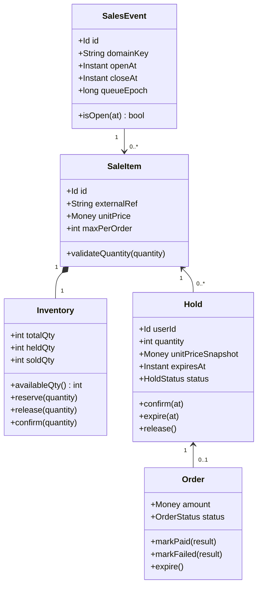
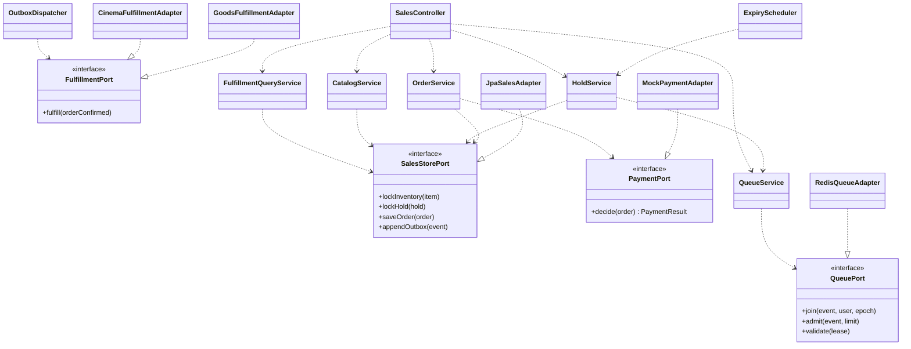
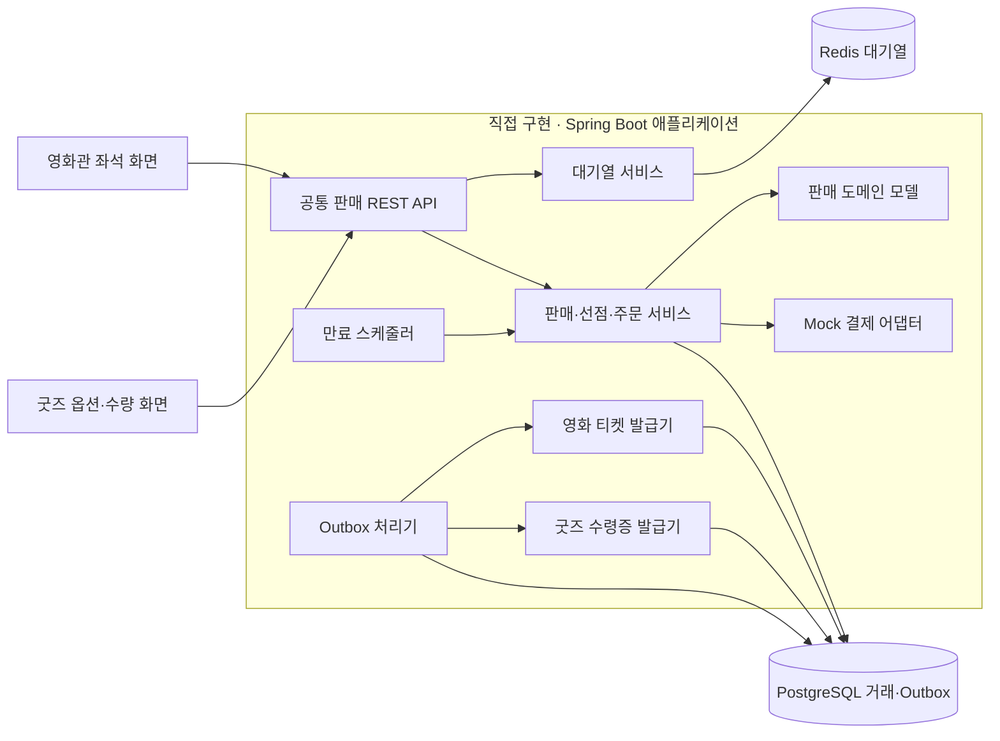
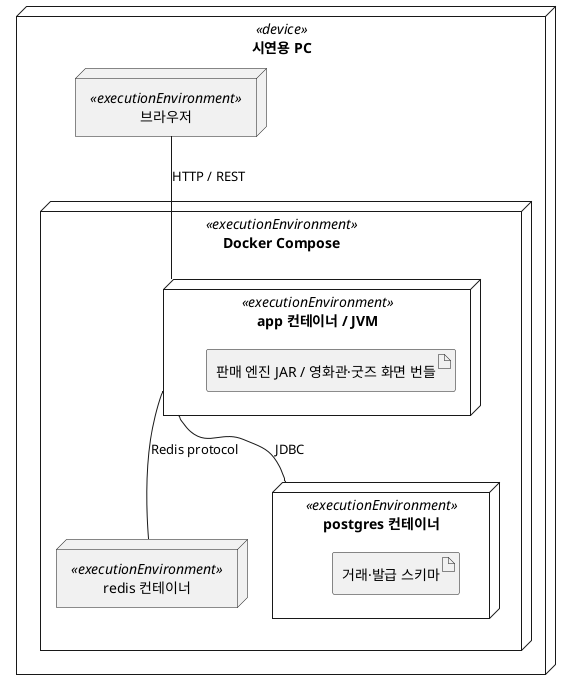
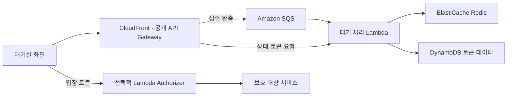

# Ticketing System v3 — 재사용 가능한 선착순 판매 엔진

국민대학교 소프트웨어 아키텍처 HW3 설계 원고 · 홍석준 · 1인 팀

## 1. 프로젝트와 진행 사항

Ticketing System은 한정된 판매 자원에 대한 대기열, 수량 선점, 주문 및 구매 확정 API를 제공한다. 영화관과 굿즈 화면은 동일 API를 호출하는 시연 클라이언트다. 운영자가 시연용 판매 회차와 상품 드롭을 미리 등록하면 구매자는 대기 순번 확인, 수량 선택, Mock 결제, 결과물 조회까지 실행한다. 한 주문은 한 판매 항목을 담고, 항목의 구매 한도 안에서 여러 개를 구매할 수 있다. 실제 결제, 배송, 구매 완료 후 환불, 장바구니, 판매 이벤트 간 공유 재고는 후속 범위다.

1인 팀인 홍석준이 요구 분석, 코어 및 어댑터 설계, 문서와 시연 검증을 담당한다. HW1 제안서와 v2 DB 중심 설계를 작성했고, v3에서는 좌석·수량형 상품을 통합하고 요구사항·구조·품질 목표를 연결했다. 애플리케이션 구현과 테스트는 예정 상태다. 최종 제출 시 기존 HW1의 팀원 학적 정보를 옮긴다.

As-Is는 판매 서비스별로 대기열과 재고·주문 규칙을 따로 만드는 구조다. To-Be는 도메인 화면과 결과물만 교체하고 동일 판매 엔진을 호출하는 구조다. 재사용은 영화 좌석 1개와 굿즈 2개를 같은 서비스와 API로 처리하는 두 시연으로 검증한다.

## 2. 기능·클래스·품질 추적

| ID | 기능 요구사항 | API 또는 실행 진입점 |
|---|---|---|
| FR1 | 운영자가 이벤트와 판매 항목·초기 수량을 등록하고 구매자는 판매 항목을 조회한다 | POST /api/events, GET /api/events/{eventId}/items |
| FR2 | 이벤트별 순번을 받고 차례가 오면 입장 권한을 얻는다 | POST /api/events/{eventId}/queue, GET /api/events/{eventId}/queue/me |
| FR3 | 입장 권한으로 한 항목의 수량을 임시 선점한다 | POST /api/events/{eventId}/holds |
| FR4 | 소유자가 선점을 해제하거나 시간이 지나면 수량을 복원한다 | DELETE /api/holds/{holdId}, 만료 스케줄러 |
| FR5 | 선점으로 주문을 만들고 Mock 결제 결과를 기록한다 | POST /api/orders, POST /api/orders/{orderId}/pay |
| FR6 | 구매 확정 후 도메인별 결과물을 발급하고 구매자에게 보여 준다 | OrderConfirmed, GET /api/orders/{orderId}/fulfillment |

| ID | NFR의 검증 가능한 조건 | Quality Attribute |
|---|---|---|
| N1 | 동일 좌석에 50명이 경쟁해도 구매 확정 최대 1건. 총량 100인 굿즈에서 선점+판매 수량이 100을 넘지 않음 | 데이터 무결성 |
| N2 | 정상 시연 부하에서 만료 후 5초 이내 수량 복원 목표. 결제·만료 경합 및 중복 실행에서 수량 한 번만 변경 | 신뢰성·복구성 |
| N3 | 20명/초 입장 상한의 시연 부하에서 선점 API p95 500ms 미만 목표. 대기 시간과 재고 부족 응답을 별도 집계 | 성능 효율성 |
| N4 | 영화관·굿즈 시연에서 동일한 HoldService·OrderService 사용. 새 도메인의 화면과 발급기 추가 시 기존 코어 파일 수정 0개 | 변경 용이성·재사용성 |
| N5 | 타인의 선점·주문·결과물 및 다른 이벤트 입장권으로 접근 성공 0건 | 보안·접근 통제 |
| N6 | 동일 이벤트에서 유효 대기 항목을 건너뛴 입장 발급 0건. Redis 중단 시 신규 선점 차단, 기존 거래 계속 | 순서 정확성·장애 격리 |
| N7 | 이벤트 반복 전달 시 주문당 결과물 1건. 발급 실패 후 재시도 가능 | 신뢰성·복구성 |

### 클래스별 설계 표

| 클래스 | 역할과 책임 | 속성·정보 | 해당 FR | 아키텍처 역할·GRASP·SOLID·패턴 | NFR·QA |
|---|---|---|---|---|---|
| SalesController | HTTP 입력과 응답 매핑 | 인증 사용자, 요청 DTO | FR1–FR6 | Layered 표현 계층, GRASP Controller | N5 접근 통제 |
| CatalogService | 등록·목록 조회 조정 | 저장소 포트 | FR1 | Layered 응용 계층, SRP | N4 변경 용이성 |
| SalesEvent | 판매 기간 판단 | id, 도메인 키, 시작·종료 시각, epoch | FR1–FR3 | Domain, Information Expert | N1 무결성 |
| SaleItem | 구매 한도와 가격 관리 | eventId, 외부 참조, 가격, 한도 | FR1, FR3 | Domain, Information Expert | N4 재사용성 |
| Inventory | 선점·반환·확정 수량 관리 | totalQty, heldQty, soldQty | FR3–FR5 | Domain, Information Expert | N1 무결성 |
| Hold | 소유권과 선점 상태 전이 | userId, 수량, 가격 스냅샷, 만료 | FR3–FR5 | Domain, Information Expert | N1·N2 무결성·복구성 |
| Order | 주문과 결제 결과 상태 관리 | holdId, 금액, 상태, 승인·거절 기록 | FR5–FR6 | Domain, Information Expert | N1·N5 무결성·접근 통제 |
| QueueService | 접수·입장·권한 검증 | QueuePort, 입장률, lease | FR2–FR3 | Application, DIP | N3·N6 성능·순서 정확성 |
| RedisQueueAdapter | 순번과 입장권을 원자적으로 갱신 | 순번, 대기열, 유효 입장권 | FR2–FR3 | Hexagonal Adapter | N6 순서 정확성 |
| HoldService | 권한 검사와 선점 트랜잭션 조정 | 거래·대기열 포트 | FR3–FR4 | Application, GRASP Controller | N1·N2·N3·N5 |
| OrderService | 주문 및 결제·확정 조정 | 거래·Mock 결제 포트 | FR5 | Application, DIP | N1·N2·N5 |
| JpaSalesAdapter | DB 잠금, 거래 데이터·이벤트 영속화 | JPA, 트랜잭션 | FR1, FR3–FR6 | Hexagonal Adapter | N1·N2 무결성·복구성 |
| MockPaymentAdapter | 로컬 승인·거절 결정 | 시연 결제 정책 | FR5 | Hexagonal Adapter | 테스트 용이성 |
| ExpiryScheduler | 만료 후보 조회와 재처리 | 실행 주기, 배치 크기 | FR4 | Infrastructure → Application | N2 복구성 |
| FulfillmentQueryService | 결과물 조회와 주문 소유권 확인 | orderId, 발급 상태 | FR6 | Layered 응용 계층, SRP | N5 접근 통제 |
| OutboxDispatcher | 확정 이벤트 읽기와 재처리 | 이벤트 ID, 재시도 정보 | FR6 | Event-Driven 이벤트 소비 | N7 복구성 |
| CinemaFulfillmentAdapter | 영화 티켓 생성 | 주문 ID, 회차·좌석 참조 | FR6 | Hexagonal Adapter, OCP | N4·N7 |
| GoodsFulfillmentAdapter | 상품 수령증 생성 | 주문 ID, 옵션·수량 | FR6 | Hexagonal Adapter, OCP | N4·N7 |

## 3. UML 클래스 모델

### 도메인 연결 계약

영화관은 `(screeningId, seatId)`로 SaleItem을 등록하고 총량 및 주문당 한도를 1로 설정한다. 같은 물리 좌석은 각 회차에 독립적으로 등록한다. 굿즈는 `(dropId, variantId)`로 SaleItem을 등록하고 행사 배정 수량 및 주문당 한도를 지정한다. 두 화면은 같은 선점 요청 `{saleItemId, quantity}`를 사용한다. 상영·좌석맵과 상품 이미지·옵션은 각각의 시연 모듈에 둔다. 엔진은 중립적인 domainKey와 externalRef를 전달하며, 조립부가 도메인 키로 발급 어댑터를 선택한다.

### 거래·장애 계약

- PostgreSQL이 재고와 거래의 원본이다. Redis는 대기열·입장 권한에 사용한다. 판매 항목별로 `availableQty = totalQty - heldQty - soldQty`이며 세 수량은 음수가 될 수 없고 `heldQty + soldQty ≤ totalQty`다. DB CHECK는 행 단위 불변식을 보장하고, ACTIVE Hold 및 PAID Order 합계와 카운터의 일치는 같은 거래 트랜잭션과 통합 테스트로 확인한다.
- 등록 시 `UNIQUE(event_id, external_ref)`, 주문에는 `UNIQUE(hold_id)`를 둔다. 판매 항목당 ACTIVE Hold 개수 제한은 두지 않는다. 좌석은 총량 1로 중복 선점을 방지하고, 수량형 굿즈는 여러 ACTIVE Hold를 허용한다.
- 선점은 본인·이벤트·epoch에 묶인 입장 권한과 양의 정수 수량을 확인한다. 트랜잭션에서 Inventory 행을 잠근 뒤 판매 시간·구매 한도·가용 수량을 확인해 heldQty와 Hold를 함께 저장한다. 선점·주문의 요청 키는 사용자·연산 기준으로 유일하며, 요청 내용이 같은 재시도는 기존 결과를 반환하고 내용이 다른 재사용은 409로 처리한다. 동시 재전송은 DB 유니크 키로 직렬화한다. 요청 키 행부터 확보하고, 동일 키로 경합한 요청에는 선행 커밋 결과를 조회해 반환한다.
- 결제·만료·해제는 Inventory → Hold → 기존 Order 순으로 잠근다. 잠금 획득 후 DB의 현재 시각을 읽어 `now >= expiresAt`이면 확정을 거절한다. 해제나 만료는 ACTIVE Hold에 대해서만 heldQty를 낮추고 연결된 PENDING 주문을 종료한다. 한 트랜잭션에서 실행하므로 중복 작업은 수량에 영향을 주지 않는다.
- 결제는 로컬 Mock 결과를 사용한다. 승인 시 Hold CONFIRMED, Order PAID, heldQty 감소, soldQty 증가, OrderConfirmed Outbox 저장을 한 트랜잭션으로 처리한다. 거절 시 Hold RELEASED, Order FAILED 및 선점 반환을 함께 기록한다. 이미 종료된 주문의 결제 재시도는 기록된 상태를 반환한다.
- Outbox 소비는 재시도 가능하며, 발급 저장소는 orderId의 유일성으로 결과물을 한 번만 만든다. 저장 직후 소비 상태를 기록하기 전에 중단되더라도 같은 결과물을 조회한다. 주문은 PAID 시점부터 구매 완료이고 결과물 미생성 상태는 발급 중으로 표시한다.
- 대기 순번은 Redis에서 이벤트별 증가 순번으로 배정한다. 원자적 연산에서 중복 접수와 입장률을 관리한다. 순서의 기준은 서비스가 순번을 배정한 시점이며 보장 범위는 구매 시도 권한의 발급까지다. Redis 상태 유실 시 신규 입장과 선점을 닫고 epoch 갱신 및 재접수를 안내한다. 기존 선점의 결제와 해제는 DB에서 진행한다.

## 4. 구성도·아키텍처 스타일

| 스타일 | 구조에서의 역할 | 품질과 비용 |
|---|---|---|
| Layered | Controller가 HTTP를 받고 Application이 유스케이스·트랜잭션을 조정하며 Domain이 수량과 상태 전이를 소유 | HTTP·화면 변경의 영향 범위를 줄인다. 계층 간 매핑은 늘어난다. |
| Ports & Adapters | 코어의 QueuePort, SalesStorePort, PaymentPort를 기술 어댑터에 연결하고 도메인 발급기를 FulfillmentPort로 연결 | 기술·시연 도메인 교체가 쉽다. 포트 계약과 통합 테스트가 필요하다. |
| Event-Driven | 확정 트랜잭션이 OrderConfirmed를 Outbox에 기록하고 처리기가 도메인 어댑터에 전달 | 구매와 결과물 발급을 분리한다. 발급 지연·재시도·중복 제거를 관리한다. |

## 5. UML 배치도 원본

PlantUML로 렌더링할 수 있다. 시연용 PC에서 브라우저가 Spring Boot가 제공하는 두 화면과 REST API에 접근한다. 만료·Outbox 작업은 같은 애플리케이션 프로세스에서 실행한다.

| 제공 기술 | 프로젝트에서 직접 구현하는 부분 |
|---|---|
| Spring MVC·Security | 공통 REST 계약, 데모 인증 사용자, 운영자 권한·소유권 검사 |
| Spring Transaction·JPA·PostgreSQL | 잠금 순서, 수량 불변식, 트랜잭션 및 Outbox 스키마 |
| Redis 자료구조·원자 연산 | 접수 중복 제거, 순번·입장률·epoch 정책 |
| React | 영화관 좌석맵과 굿즈 옵션·수량 선택, 공통 구매 API 호출 |
| Docker Compose | 앱·DB·대기열 실행 구성과 시연 fixture |

## 6. 조사 시스템과 설계 반영

AWS Virtual Waiting Room의 공식 구조에서 구매자 화면은 대기 Core API에 순번과 상태를 요청한다. 공개 API의 폭주를 SQS로 완충하고 Lambda가 대기 상태를 처리한다. 참조 구현에는 ElastiCache Redis 클러스터와 토큰 저장용 DynamoDB가 포함되며, 보호된 시스템 앞의 선택적 Authorizer가 입장 토큰을 검증한다. 아래 그림은 공식 구조도와 개발자 가이드에서 대기·입장 경로를 요약한 것이다.

| 조사한 구성 | 본 프로젝트에 반영하는 부분 |
|---|---|
| 대기 화면·Core API | 시연 화면의 순번 조회와 공통 대기열 API |
| 대기 상태 처리와 유입 평탄화 | Spring QueueService 및 RedisQueueAdapter의 순번·제한 입장 |
| 입장 토큰 및 Authorizer | 이벤트·사용자·epoch에 결합된 입장 권한과 HoldService의 선점 전 검사 |
| 보호 대상 서비스 | PostgreSQL 기반의 공통 선점·주문 엔진 |

차용 대상은 대기열과 보호 대상 서비스 사이의 경계 및 제한 입장 방식이다. 프로젝트의 실행 구성은 Spring Boot, Redis, PostgreSQL이며 AWS 서비스와 구현 코드를 가져오는 의존성은 없다.

## 7. 시연 구현과 검증 계획

1. PostgreSQL 모델·스키마·잠금과 만료를 먼저 구현한다. 좌석 총량 1과 굿즈 총량 100을 같은 테스트 케이스의 데이터 변형으로 검증한다.
2. 순번과 입장 검증, Mock 결제, Outbox 발급을 연결한다. 동일 키 재요청, 잠금 대기 중 만료, 거절 후 재선점, Outbox 중복, 타인 접근, Redis 중단을 시험한다.
3. 두 시연 화면을 같은 앱에 연결한다. 영화관에서는 동일 좌석 경합·티켓 발급을, 굿즈에서는 수량 2개 구매·일부 선점 만료·상품 수령증을 보여 준다.
4. 두 화면의 API 요청과 DB 최종 수량을 대조한다. 성능 목표는 시연 PC 사양, 입장률, 부하 시간, 좌석·상품 요청 분포를 함께 기록해 측정한다. 위 수치는 검증 계획이다.
5. 제출본 편집 시 분석·설계와 전체 구성도를 각각 한 페이지 이상으로 배치하고, UML 다이어그램과 표의 페이지 나눔을 확인한다. 마지막 장에는 참고문헌을 둔다.

## 참고문헌

- AWS, [AWS Virtual Waiting Room 공식 아키텍처 도식](https://d1.awsstatic.com/architecture-diagrams/ArchitectureDiagrams/aws-virtual-waiting-room-sol.pdf).
- AWS, [Introducing AWS Virtual Waiting Room](https://aws.amazon.com/blogs/compute/introducing-aws-virtual-waiting-room/).
- AWS Solutions, [Virtual Waiting Room Developer Guide](https://github.com/aws-solutions/virtual-waiting-room-on-aws/blob/main/docs/developer-guide.md).
- PostgreSQL, [Explicit Locking](https://www.postgresql.org/docs/current/explicit-locking.html).
- 국민대학교 Software Architecture, HW 3 Term Project Analysis and Design v3, 2–6쪽.
