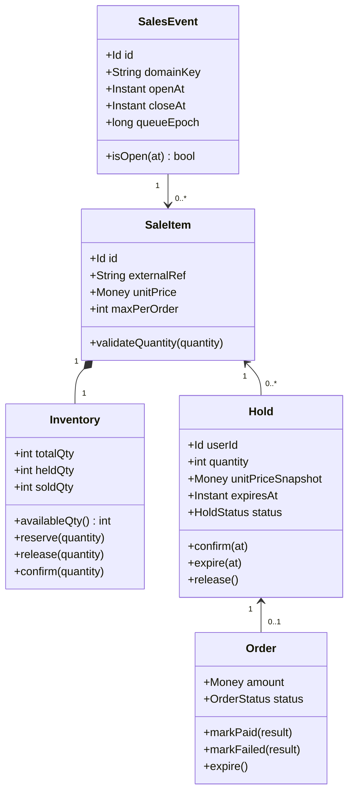
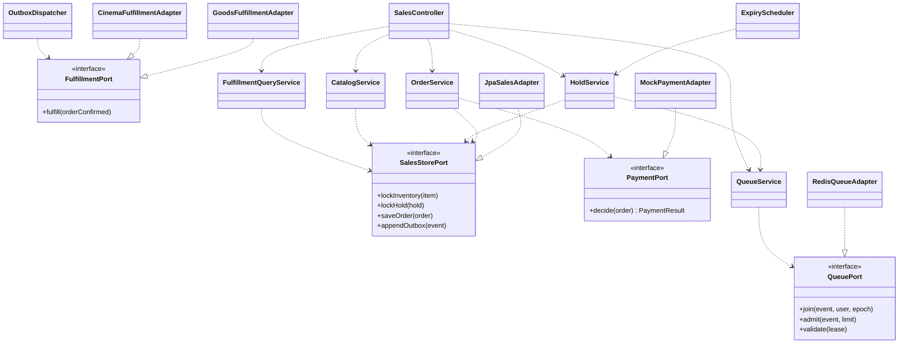
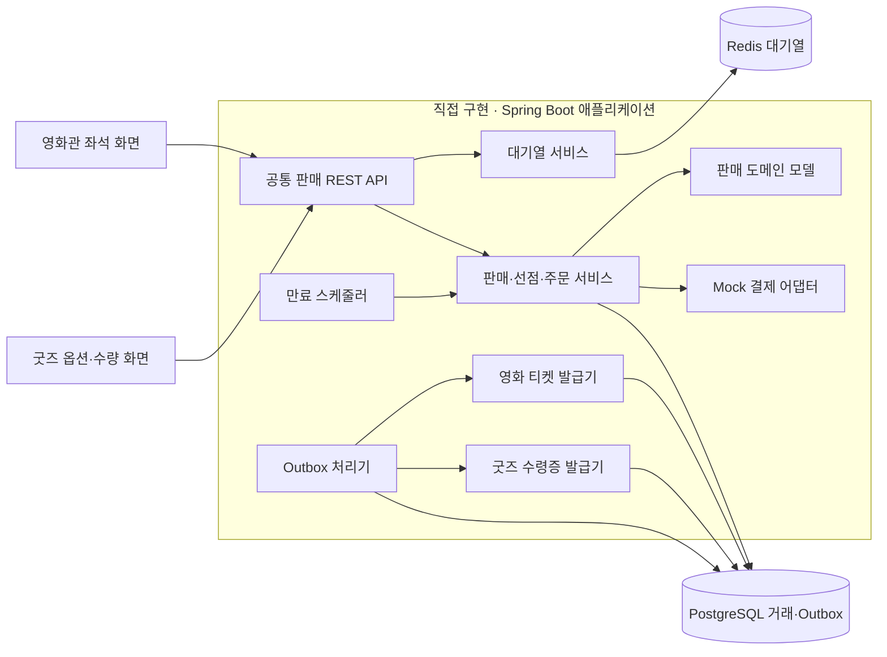
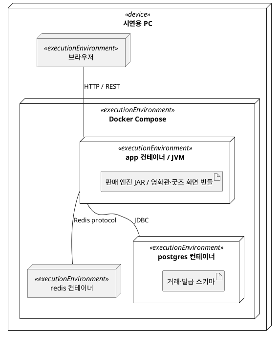
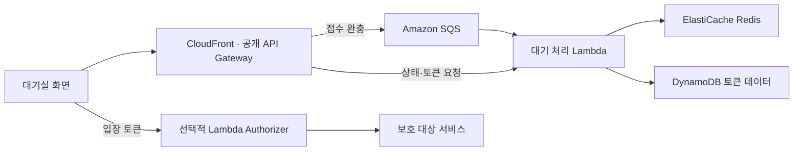

# Ticketing System 분석 및 설계보고서 v4

국민대학교 소프트웨어 아키텍처 HW3 · 홍석준 · 20213098 · 소프트웨어학과 4학년 · 1인 팀

## 1. 프로젝트와 진행 사항

Ticketing System은 한정된 판매 자원에 대한 대기열, 수량 선점, 주문 및 구매 확정 API를 제공한다. 영화관과 굿즈 화면은 동일 API를 호출하는 시연 클라이언트다. 운영자가 시연용 판매 회차와 상품 드롭을 미리 등록하면 구매자는 대기 순번 확인, 수량 선택, Mock 결제, 결과물 조회까지 실행한다. 한 주문은 한 판매 항목을 담고, 항목의 구매 한도 안에서 여러 개를 구매할 수 있다. 실제 결제, 배송, 구매 완료 후 환불, 장바구니, 판매 이벤트 간 공유 재고는 후속 범위다.

1인 팀인 홍석준이 요구 분석, 코어 및 어댑터 설계, 문서와 시연 검증을 담당한다. HW1 제안서와 v2 DB 중심 설계를 작성했고, v3에서는 좌석·수량형 상품을 통합하고 요구사항·구조·품질 목표를 연결했다. 애플리케이션 구현과 테스트는 예정 상태다. 설계 검수와 구현 계약 확정까지 완료했다.

As-Is는 판매 서비스별로 대기열과 재고·주문 규칙을 따로 만드는 구조다. To-Be는 도메인 화면과 결과물만 교체하고 동일 판매 엔진을 호출하는 구조다. 재사용은 영화 좌석 1개와 굿즈 2개를 같은 서비스와 API로 처리하는 두 시연으로 검증한다.

## 2. 기능·클래스·품질 추적

| ID | 기능 요구사항 | API 또는 실행 진입점 |
|---|---|---|
| FR1 | 운영자가 이벤트와 판매 항목·초기 수량을 등록하고 구매자는 판매 항목을 조회한다 | POST /api/events, GET /api/events/{eventId}/items |
| FR2 | 이벤트별 순번을 받고 차례가 오면 입장 권한을 얻는다 | POST /api/events/{eventId}/queue, GET /api/events/{eventId}/queue/me |
| FR3 | 입장 권한으로 한 항목의 수량을 임시 선점한다 | POST /api/events/{eventId}/holds |
| FR4 | 소유자가 선점을 해제하거나 시간이 지나면 수량을 복원한다 | DELETE /api/holds/{holdId}, 만료 스케줄러 |
| FR5 | 선점으로 주문을 만들고 Mock 결제 결과를 기록한다 | POST /api/orders, POST /api/orders/{orderId}/pay |
| FR6 | 구매 확정 후 도메인별 결과물을 발급하고 구매자에게 보여 준다 | OrderConfirmed, GET /api/orders/{orderId}/fulfillment |

| ID | NFR의 검증 가능한 조건 | Quality Attribute |
|---|---|---|
| N1 | 동일 좌석에 50명이 경쟁해도 구매 확정 최대 1건. 총량 100인 굿즈에서 선점+판매 수량이 100을 넘지 않음 | 데이터 무결성 |
| N2 | 정상 시연 부하에서 만료 후 5초 이내 수량 복원 목표. 결제·만료 경합 및 중복 실행에서 수량 한 번만 변경 | 신뢰성·복구성 |
| N3 | 20명/초 입장 상한의 시연 부하에서 선점 API p95 500ms 미만 목표. 대기 시간과 재고 부족 응답을 별도 집계 | 성능 효율성 |
| N4 | 영화관·굿즈 시연에서 동일한 HoldService·OrderService 사용. 새 도메인의 화면과 발급기 추가 시 기존 코어 파일 수정 0개 | 변경 용이성·재사용성 |
| N5 | 타인의 선점·주문·결과물 및 다른 이벤트 입장권으로 접근 성공 0건 | 보안·접근 통제 |
| N6 | 동일 이벤트에서 유효 대기 항목을 건너뛴 입장 발급 0건. Redis 중단 시 신규 선점 차단, 기존 거래 계속 | 순서 정확성·장애 격리 |
| N7 | 이벤트 반복 전달 시 주문당 결과물 1건. 발급 실패 후 재시도 가능 | 신뢰성·복구성 |

### 클래스별 설계 표

| 클래스 | 역할과 책임 | 속성·정보 | 해당 FR | 아키텍처 역할·GRASP·SOLID·패턴 | NFR·QA |
|---|---|---|---|---|---|
| SalesController | HTTP 입력과 응답 매핑 | 인증 사용자, 요청 DTO | FR1–FR6 | Layered 표현 계층, GRASP Controller | N5 접근 통제 |
| CatalogService | 등록·목록 조회 조정 | 저장소 포트 | FR1 | Layered 응용 계층, SRP | N4 변경 용이성 |
| SalesEvent | 판매 기간 판단 | id, 도메인 키, 시작·종료 시각, epoch | FR1–FR3 | Domain, Information Expert | N1 무결성 |
| SaleItem | 구매 한도와 가격 관리 | eventId, 외부 참조, 가격, 한도 | FR1, FR3 | Domain, Information Expert | N4 재사용성 |
| Inventory | 선점·반환·확정 수량 관리 | totalQty, heldQty, soldQty | FR3–FR5 | Domain, Information Expert | N1 무결성 |
| Hold | 소유권과 선점 상태 전이 | userId, 수량, 가격 스냅샷, 만료 | FR3–FR5 | Domain, Information Expert | N1·N2 무결성·복구성 |
| Order | 주문과 결제 결과 상태 관리 | holdId, 금액, 상태, 승인·거절 기록 | FR5–FR6 | Domain, Information Expert | N1·N5 무결성·접근 통제 |
| QueueService | 접수·입장·권한 검증 | QueuePort, 입장률, lease | FR2–FR3 | Application, DIP | N3·N6 성능·순서 정확성 |
| RedisQueueAdapter | 순번과 입장권을 원자적으로 갱신 | 순번, 대기열, 유효 입장권 | FR2–FR3 | Hexagonal Adapter | N6 순서 정확성 |
| HoldService | 권한 검사와 선점 트랜잭션 조정 | 거래·대기열 포트 | FR3–FR4 | Application, GRASP Controller | N1·N2·N3·N5 |
| OrderService | 주문 및 결제·확정 조정 | 거래·Mock 결제 포트 | FR5 | Application, DIP | N1·N2·N5 |
| JpaSalesAdapter | DB 잠금, 거래 데이터·이벤트 영속화 | JPA, 트랜잭션 | FR1, FR3–FR6 | Hexagonal Adapter | N1·N2 무결성·복구성 |
| MockPaymentAdapter | 로컬 승인·거절 결정 | 시연 결제 정책 | FR5 | Hexagonal Adapter | 테스트 용이성 |
| ExpiryScheduler | 만료 후보 조회와 재처리 | 실행 주기, 배치 크기 | FR4 | Infrastructure → Application | N2 복구성 |
| FulfillmentQueryService | 결과물 조회와 주문 소유권 확인 | orderId, 발급 상태 | FR6 | Layered 응용 계층, SRP | N5 접근 통제 |
| OutboxDispatcher | 확정 이벤트 읽기와 재처리 | 이벤트 ID, 재시도 정보 | FR6 | Event-Driven 이벤트 소비 | N7 복구성 |
| CinemaFulfillmentAdapter | 영화 티켓 생성 | 주문 ID, 회차·좌석 참조 | FR6 | Hexagonal Adapter, OCP | N4·N7 |
| GoodsFulfillmentAdapter | 상품 수령증 생성 | 주문 ID, 옵션·수량 | FR6 | Hexagonal Adapter, OCP | N4·N7 |

## 3. UML 클래스 모델

### 도메인 연결 계약

영화관은 `(screeningId, seatId)`로 SaleItem을 등록하고 총량 및 주문당 한도를 1로 설정한다. 같은 물리 좌석은 각 회차에 독립적으로 등록한다. 굿즈는 `(dropId, variantId)`로 SaleItem을 등록하고 행사 배정 수량 및 주문당 한도를 지정한다. 두 화면은 같은 선점 요청 `{saleItemId, quantity}`를 사용한다. 상영·좌석맵과 상품 이미지·옵션은 각각의 시연 모듈에 둔다. 엔진은 중립적인 domainKey와 externalRef를 전달하며, 조립부가 도메인 키로 발급 어댑터를 선택한다.

### 거래·장애 계약

- PostgreSQL이 재고와 거래의 원본이다. Redis는 대기열·입장 권한에 사용한다. 판매 항목별로 `availableQty = totalQty - heldQty - soldQty`이며 세 수량은 음수가 될 수 없고 `heldQty + soldQty ≤ totalQty`다. DB CHECK는 행 단위 불변식을 보장하고, ACTIVE Hold 및 PAID Order 합계와 카운터의 일치는 같은 거래 트랜잭션과 통합 테스트로 확인한다.
- 등록 시 `UNIQUE(event_id, external_ref)`, 주문에는 `UNIQUE(hold_id)`를 둔다. 판매 항목당 ACTIVE Hold 개수 제한은 두지 않는다. 좌석은 총량 1로 중복 선점을 방지하고, 수량형 굿즈는 여러 ACTIVE Hold를 허용한다.
- 선점은 본인·이벤트·epoch에 묶인 입장 권한과 양의 정수 수량을 확인한다. 트랜잭션에서 Inventory 행을 잠근 뒤 판매 시간·구매 한도·가용 수량을 확인해 heldQty와 Hold를 함께 저장한다. 선점·주문의 요청 키는 사용자·연산 기준으로 유일하며, 요청 내용이 같은 재시도는 기존 결과를 반환하고 내용이 다른 재사용은 409로 처리한다. 동시 재전송은 DB 유니크 키로 직렬화한다. 요청 키 행부터 확보하고, 동일 키로 경합한 요청에는 선행 커밋 결과를 조회해 반환한다.
- 결제·만료·해제는 Inventory → Hold → 기존 Order 순으로 잠근다. 잠금 획득 후 DB의 현재 시각을 읽어 `now >= expiresAt`이면 확정을 거절한다. 해제나 만료는 ACTIVE Hold에 대해서만 heldQty를 낮추고 연결된 PENDING 주문을 종료한다. 한 트랜잭션에서 실행하므로 중복 작업은 수량에 영향을 주지 않는다.
- 결제는 로컬 Mock 결과를 사용한다. 승인 시 Hold CONFIRMED, Order PAID, heldQty 감소, soldQty 증가, OrderConfirmed Outbox 저장을 한 트랜잭션으로 처리한다. 거절 시 Hold RELEASED, Order FAILED 및 선점 반환을 함께 기록한다. 이미 종료된 주문의 결제 재시도는 기록된 상태를 반환한다.
- Outbox 소비는 재시도 가능하며, 발급 저장소는 orderId의 유일성으로 결과물을 한 번만 만든다. 저장 직후 소비 상태를 기록하기 전에 중단되더라도 같은 결과물을 조회한다. 주문은 PAID 시점부터 구매 완료이고 결과물 미생성 상태는 발급 중으로 표시한다.
- 대기 순번은 Redis에서 이벤트별 증가 순번으로 배정한다. 원자적 연산에서 중복 접수와 입장률을 관리한다. 순서의 기준은 서비스가 순번을 배정한 시점이며 보장 범위는 구매 시도 권한의 발급까지다. Redis 상태 유실 시 신규 입장과 선점을 닫고 epoch 갱신 및 재접수를 안내한다. 기존 선점의 결제와 해제는 DB에서 진행한다.

## 4. 구성도·아키텍처 스타일

| 스타일 | 구조에서의 역할 | 품질과 비용 |
|---|---|---|
| Layered | Controller가 HTTP를 받고 Application이 유스케이스·트랜잭션을 조정하며 Domain이 수량과 상태 전이를 소유 | HTTP·화면 변경의 영향 범위를 줄인다. 계층 간 매핑은 늘어난다. |
| Ports & Adapters | 코어의 QueuePort, SalesStorePort, PaymentPort를 기술 어댑터에 연결하고 도메인 발급기를 FulfillmentPort로 연결 | 기술·시연 도메인 교체가 쉽다. 포트 계약과 통합 테스트가 필요하다. |
| Event-Driven | 확정 트랜잭션이 OrderConfirmed를 Outbox에 기록하고 처리기가 도메인 어댑터에 전달 | 구매와 결과물 발급을 분리한다. 발급 지연·재시도·중복 제거를 관리한다. |

## 5. UML 배치도 원본

PlantUML로 렌더링할 수 있다. 시연용 PC에서 브라우저가 Spring Boot가 제공하는 두 화면과 REST API에 접근한다. 만료·Outbox 작업은 같은 애플리케이션 프로세스에서 실행한다.

| 제공 기술 | 프로젝트에서 직접 구현하는 부분 |
|---|---|
| Spring MVC·Security | 공통 REST 계약, 데모 인증 사용자, 운영자 권한·소유권 검사 |
| Spring Transaction·JPA·PostgreSQL | 잠금 순서, 수량 불변식, 트랜잭션 및 Outbox 스키마 |
| Redis 자료구조·원자 연산 | 접수 중복 제거, 순번·입장률·epoch 정책 |
| React | 영화관 좌석맵과 굿즈 옵션·수량 선택, 공통 구매 API 호출 |
| Docker Compose | 앱·DB·대기열 실행 구성과 시연 fixture |

## 6. 조사 시스템과 설계 반영

AWS Virtual Waiting Room의 공식 구조에서 구매자 화면은 대기 Core API에 순번과 상태를 요청한다. 공개 API의 폭주를 SQS로 완충하고 Lambda가 대기 상태를 처리한다. 참조 구현에는 ElastiCache Redis 클러스터와 토큰 저장용 DynamoDB가 포함되며, 보호된 시스템 앞의 선택적 Authorizer가 입장 토큰을 검증한다. 아래 그림은 공식 구조도와 개발자 가이드에서 대기·입장 경로를 요약한 것이다.

| 조사한 구성 | 본 프로젝트에 반영하는 부분 |
|---|---|
| 대기 화면·Core API | 시연 화면의 순번 조회와 공통 대기열 API |
| 대기 상태 처리와 유입 평탄화 | Spring QueueService 및 RedisQueueAdapter의 순번·제한 입장 |
| 입장 토큰 및 Authorizer | 이벤트·사용자·epoch에 결합된 입장 권한과 HoldService의 선점 전 검사 |
| 보호 대상 서비스 | PostgreSQL 기반의 공통 선점·주문 엔진 |

차용 대상은 대기열과 보호 대상 서비스 사이의 경계 및 제한 입장 방식이다. 프로젝트의 실행 구성은 Spring Boot, Redis, PostgreSQL이며 AWS 서비스와 구현 코드를 가져오는 의존성은 없다.

## 7. 시연 구현과 검증 계획

1. PostgreSQL 모델·스키마·잠금과 만료를 먼저 구현한다. 좌석 총량 1과 굿즈 총량 100을 같은 테스트 케이스의 데이터 변형으로 검증한다.
2. 순번과 입장 검증, Mock 결제, Outbox 발급을 연결한다. 동일 키 재요청, 잠금 대기 중 만료, 거절 후 재선점, Outbox 중복, 타인 접근, Redis 중단을 시험한다.
3. 두 시연 화면을 같은 앱에 연결한다. 영화관에서는 동일 좌석 경합·티켓 발급을, 굿즈에서는 수량 2개 구매·일부 선점 만료·상품 수령증을 보여 준다.
4. 두 화면의 API 요청과 DB 최종 수량을 대조한다. 성능 목표는 시연 PC 사양, 입장률, 부하 시간, 좌석·상품 요청 분포를 함께 기록해 측정한다. 위 수치는 검증 계획이다.
5. 제출본 편집 시 분석·설계와 전체 구성도를 각각 한 페이지 이상으로 배치하고, UML 다이어그램과 표의 페이지 나눔을 확인한다. 마지막 장에는 참고문헌을 둔다.

## 8. 최종 검수와 구현 결정

검수 결과 수량형 코어의 방향은 타당하다. 구현 판단이 남아 있던 입장권의 재사용, 잠금 이후 시각, 주문 생성과 만료의 경합, Outbox 작업 중단, 인증·오류 응답을 아래 계약으로 확정한다. 본 보고서는 설계 검수 결과이며 실제 구현의 동작 검증은 10장의 테스트로 수행한다.

### 8.1 코드 구성과 의존성

단일 Gradle Spring Boot 프로젝트와 React UI를 사용한다. 기본 패키지는 com.ticketing이다.

| 패키지 | 구현 내용 | 허용 의존성 |
|---|---|---|
| core.domain | SalesEvent, SaleItem, Inventory, Hold, Order, 상태 enum, Money | Java 표준 API |
| core.application | CatalogService, QueueService, HoldService, OrderService, FulfillmentQueryService 및 command/result | domain, port |
| core.port | SalesStorePort, QueuePort, PaymentPort, FulfillmentPort, OutboxStorePort, FulfillmentStorePort | domain |
| adapter.web | 인증·운영자·판매 API Controller, 예외 매핑, DTO | application |
| adapter.persistence | JPA 엔티티·매핑, 행 잠금, 포트 구현 | port, domain, JPA |
| adapter.redis | 접수·입장 Lua와 QueuePort 구현 | port, Redis |
| adapter.mock | 로컬 결제 승인·거절 | PaymentPort |
| demo.cinema, demo.goods | 표시 데이터·결과물 발급 어댑터 | FulfillmentPort |
| bootstrap | Spring Bean 조립, TransactionTemplate 경계, 스케줄러, 보안 | 각 모듈 |
| frontend | cinema, goods 화면과 공통 구매 API 클라이언트 | REST 계약 |

Application 서비스는 bootstrap에서 주입한 트랜잭션 실행기를 통해 변경 유스케이스 전체를 하나의 트랜잭션으로 실행한다. 저장소 포트 메서드마다 독립 커밋하지 않는다. SQL 락 쿼리는 adapter.persistence가 소유한다. 시간 판단은 잠금을 얻은 후 PostgreSQL clock_timestamp()로 수행한다. 트랜잭션 시작 시각을 반환하는 now()는 만료 판단에 사용하지 않는다.

### 8.2 데이터 계약

식별자는 UUID, 시각은 TIMESTAMPTZ/UTC, 수량은 정수, 금액은 원 단위 BIGINT로 고정한다. 필수 값은 모두 NOT NULL이다. ID·상태 및 외래키에 명시적 제약을 둔다.

| 테이블 | 필수 열 | 제약과 인덱스 |
|---|---|---|
| sales_event | id, domain_key, title, open_at, close_at, queue_epoch | close_at > open_at |
| sale_item | id, event_id, external_ref, name, unit_price, max_per_order | event FK, UNIQUE(event_id, external_ref), price >= 0, max >= 1 |
| inventory | sale_item_id, total_qty, held_qty, sold_qty | item PK/FK, 각 수량 >= 0, held + sold <= total |
| hold | id, sale_item_id, user_id, quantity, unit_price_snapshot, expires_at, status | item FK, quantity > 0, ACTIVE/CONFIRMED/EXPIRED/RELEASED, INDEX(status, expires_at) |
| orders | id, hold_id, user_id, amount, status, payment_result | hold FK UNIQUE, PENDING/PAID/FAILED/EXPIRED/CANCELLED, amount >= 0 |
| idempotency_request | user_id, operation, key, request_hash, response_status, response_json | 복합 PK(user_id, operation, key) |
| outbox_event | id, order_id, type, payload, status, attempts, next_attempt_at, last_error | order FK, UNIQUE(order_id, type), NEW/DONE/FAILED, INDEX(status, next_attempt_at) |
| fulfillment | order_id, kind, code, payload, issued_at | order PK/FK, code UNIQUE |

payment_result는 PENDING에서 null, PAID에서 APPROVED, 결제 거절로 FAILED가 되면 DECLINED다. 주문의 user_id는 Hold 소유자와 일치해야 한다. amount는 서버의 선점 가격 스냅샷 × 수량으로 계산한다. 초기 판매 항목은 개장 전 등록하고 개장 후 가격·총수량을 변경하는 API는 제공 범위 밖이다. max_per_order는 주문별 한도이며 사용자 누적 구매 제한은 후속 정책이다.

영화관 표시 데이터에는 screening(id, movie_title, starts_at, event_id)와 screening_seat(screening_id, seat_code, sale_item_id)를 둔다. UNIQUE(screening_id, seat_code) 및 sale_item_id UNIQUE로 연결한다. 굿즈 표시 데이터에는 goods_variant(id, product_name, option_label, sale_item_id UNIQUE)를 둔다. 각 sale_item_id에 FK를 둔다.

### 8.3 API 공통 규칙과 응답

동일 오리진에서 UI와 API를 제공한다. Spring Security 세션 인증과 CSRF 토큰을 사용하고 데모 계정 ADMIN 1개, BUYER 50개를 seed한다. 서버가 인증 주체의 ID를 사용하며 요청 본문의 userId는 받지 않는다. GET /api/me가 사용자와 CSRF 토큰을 제공한다. 로그인·로그아웃은 Spring Security 세션 흐름을 사용한다.

POST /api/events는 ADMIN 전용이며 {domainKey,title,openAt,closeAt,items:[{externalRef,name,unitPrice,totalQty,maxPerOrder}]}를 하나의 트랜잭션으로 등록한다. 성공은 201과 eventId다. GET /api/events 및 GET /api/events/{id}/items는 목록과 현재 availableQty를 반환한다. 조회 후 선점 사이에는 가용 수량이 바뀔 수 있다.

| 요청 | 입력 | 성공 응답 |
|---|---|---|
| POST /events/{id}/queue | 빈 본문 | 200 {position,status,leaseToken,expiresAt} |
| GET /events/{id}/queue/me | 없음 | 200 동일 형식, WAITING이면 토큰 null |
| POST /events/{id}/holds | {saleItemId,quantity}, X-Queue-Token, Idempotency-Key | 201 {holdId,status,quantity,expiresAt,amount} |
| DELETE /holds/{id} | 없음 | 200 {holdId,status} |
| POST /orders | {holdId}, Idempotency-Key | 201 {orderId,status,amount} |
| POST /orders/{id}/pay | {mockResult: APPROVED 또는 DECLINED}, Idempotency-Key | 200 {orderId,status,fulfillmentStatus} |
| GET /orders/{id} | 없음 | 200 주문 상태·금액·선점 만료 시각 |
| GET /orders/{id}/fulfillment | 없음 | PAID 발급 대기 202, 발급 완료 200 {kind,code,payload} |

모든 경로에는 /api 접두사가 있다. 잘못된 입력 400, 미인증 401, 권한 없는 관리자 작업 403, 없는 리소스 또는 타인 리소스 404, 재고 부족·상태 충돌·키 재사용 불일치 409, 만료된 입장권 409, 대기열 장애 503으로 통일한다. 오류 본문은 {code,message,requestId}다. 판매 품절과 결제 거절은 예상 업무 결과로 별도 집계한다. 의도된 부하 테스트에서는 API별 성공·업무 거절·시스템 오류와 p95를 함께 기록한다.

### 8.4 멱등성과 잠금

1. 변경 요청의 멱등 키를 INSERT ON CONFLICT DO NOTHING으로 확보한다. 동일 키면 요청 해시와 저장된 응답을 조회한다. 이 행은 변경과 같은 트랜잭션에서 저장하고, 기술 실패 시 함께 롤백한다.
2. 신규 선점은 입장 검증 후 요청 키 → Inventory 순으로 잠근다. 이미 완료된 동일 요청의 응답 재생에는 입장권을 다시 요구하지 않는다. 소유권은 항상 검사한다.
3. 주문 생성·결제·해제·만료는 item ID를 불변 참조로 먼저 읽고 Inventory → Hold → Order 순으로 잠근 후 모든 상태와 권한을 재검증한다. 스케줄러는 후보 ID만 읽고 개별 트랜잭션으로 같은 서비스를 호출한다.
4. 만료 시 Hold EXPIRED와 재고 반환, 연결된 PENDING 주문 EXPIRED를 커밋한다. 사용자 요청에는 커밋 후 만료 응답을 반환한다. 예외를 던져 만료 처리를 롤백하지 않는다.
5. 해제 시 Hold RELEASED, 기존 PENDING 주문 CANCELLED다. CONFIRMED Hold 해제는 409다. 종료된 선점의 같은 해제는 현재 상태를 반환한다.
6. 같은 holdId로 주문을 다시 생성하면 소유자의 기존 주문을 반환한다. 결제도 이미 PAID/FAILED/EXPIRED/CANCELLED이면 기존 결과를 반환하며 새로운 Mock 결과로 재계산하지 않는다.

### 8.5 대기열 운영

시연 기본값은 이벤트별 초당 20명 입장, 입장권 30초, 선점 300초, 순번 조회 2초다. Lua에서 사용자 중복 접수 확인 → INCR 순번 배정 → ZADD를 원자적으로 수행한다. 사용자·이벤트·epoch당 대기 항목 하나를 유지하며 토큰은 추측 불가능한 난수다. Redis 서버 시간을 기준으로 만료를 계산한다.

1초마다 AdmissionScheduler가 단일 Lua 호출로 현재 초의 남은 발급 예산을 확인하고 순번이 작은 최대 20명에게 입장권을 발급한다. 사용자는 이후 조회에서 토큰을 받는다. 폴링 자체가 순번을 앞당기지 않는다. 입장권은 유효기간 동안 여러 선점 시도에 사용할 수 있으며 주문당 구매 한도를 적용한다.

입장 검증 성공 시 해당 요청은 구매 시도 권한을 얻는다. DB 잠금 대기 후에는 판매 기간·재고를 다시 확인한다. 검증 후 Redis 장애나 epoch 변경은 이미 승인된 요청을 취소하지 않는다. 데이터 유실 시 신규 검증을 닫고 DB epoch 증가 → 새 Redis namespace 초기화 → READY 전환 순서로 복구한다. 초기 시연은 앱 인스턴스 1개이며 복구 작업은 신규 입장 요청과 직렬화한다.

### 8.6 이벤트 처리 계약

OrderConfirmed payload는 {eventId,orderId,userId,domainKey,externalRef,quantity,amount}다. 판매 확정 시 스냅샷을 저장해 발급 시 변경된 상품 설명에 의존하지 않게 한다.

OutboxDispatcher는 1초마다 최대 20개의 처리 가능한 이벤트를 SELECT FOR UPDATE SKIP LOCKED로 읽는다. 이벤트 1개마다 독립 트랜잭션에서 로컬 발급 어댑터 호출, fulfillment 저장, DONE 갱신을 함께 커밋한다. 실패하면 전체 롤백하고 별도 짧은 트랜잭션으로 attempts와 오류·재시각을 갱신한다. 1·2·4·8·16초 간격으로 재시도하며 5회 실패 후 FAILED로 둔다. 관리자 재처리 API POST /api/admin/outbox/{id}/retry는 NEW로 되돌린다.

어댑터는 동일 PostgreSQL의 결과물 저장소를 사용한다. 이벤트 잠금과 order_id PK가 중복 결과물을 막는다. 주문 PAID와 발급 FAILED는 별도 상태로 노출하며 구매 수량은 유지한다. 외부 발송 부작용이 있는 어댑터는 추가 전송 멱등 계약이 필요하다.

## 9. 구현 순서와 완료 조건

| 단계 | 파일·기능 | 단계 완료 조건 |
|---|---|---|
| 1 | Gradle, Docker Compose, Flyway V1, demo seed | 앱·DB·Redis 기동, 두 도메인 항목 조회 |
| 2 | Domain 및 JpaSalesAdapter, HoldService | 좌석 경합·굿즈 수량·해제·만료 테스트 통과 |
| 3 | OrderService, MockPaymentAdapter, 멱등 요청 | 결제·만료 경합, 재전송, 가격 변조 테스트 통과 |
| 4 | RedisQueueAdapter, AdmissionScheduler, 세션 권한 | 순번·입장권·장애 격리·소유권 테스트 통과 |
| 5 | OutboxDispatcher, 두 FulfillmentAdapter | 재시도와 중복 이벤트 결과물 1개 |
| 6 | React 공통 구매 클라이언트, 두 화면 | 같은 API로 좌석 구매·굿즈 2개 구매 시연 |
| 7 | k6 및 시연 절차 | 실행 환경·최종 수량·지연 측정 결과 기록 |

## 10. 필수 인수 테스트

- T01 좌석 총량 1에 50개 동시 선점 요청 → 성공 1, held=1, sold=0.
- T02 굿즈 총량 100에 50명의 수량 2 요청 → 선점 합계 100. 추가 선점은 409.
- T03 선점 승인과 만료 경합 → CONFIRMED 또는 EXPIRED 한 상태, 재고 합계 일치.
- T04 DB 잠금 대기가 만료 시각을 넘으면 결제 성공 0, 재고 반환 1회.
- T05 같은 멱등 키 20회 동시 요청 → 선점·주문 각 1개. 다른 본문은 409.
- T06 같은 선점에 다른 키로 주문 생성 경쟁 → 주문 1개.
- T07 발급 저장 전 프로세스 중단·재실행 → 결과물 1개. 실패 재처리 후에도 sold 불변.
- T08 타인·타 이벤트·과거 epoch 토큰으로 선점 실패. 타인 주문 조회 404.
- T09 Redis 중단 → 신규 선점 503, 이미 선점한 주문의 결제 가능.
- T10 선점 이후 클라이언트 금액 변조 → 서버 스냅샷 금액으로 구매 확정.
- T11 DB 카운터와 ACTIVE Hold 합계·PAID Order 수량 합계 일치.
- T12 두 도메인에 같은 서비스 인스턴스 사용 및 core의 demo 패키지 의존성 0건.

통합 테스트는 Testcontainers PostgreSQL·Redis를 사용한다. 만료 테스트는 DB expires_at을 테스트 fixture로 조정하고 실제 경합을 만들어 검증한다. N3 성능 시험은 60초 준비 후 120초 측정하며 DB·앱 사양과 입장률을 결과에 기록한다. 품절 거절은 시스템 오류율에서 분리하되 전체 요청 수와 함께 공개한다.

## 11. 코딩 에이전트 인계 지시

이 보고서의 8~10장을 구현 계약으로 사용한다. v1·v2·v3 파일은 설계 이력이다. 9장의 순서로 단계마다 실행·테스트를 통과시킨 뒤 다음 단계로 진행한다. 입력 DTO와 에러 code를 공통 정의하고 화면별 판매 API를 만들지 않는다. 구현 중 계약 변경이 필요하면 변경 이유와 영향받는 테스트를 기록한다. 완료 보고에는 실행 명령, 데모 계정, 테스트 결과, 시연 주소와 두 도메인 구매 경로를 제공한다.

## 참고문헌

- AWS, [AWS Virtual Waiting Room 공식 아키텍처 도식](https://d1.awsstatic.com/architecture-diagrams/ArchitectureDiagrams/aws-virtual-waiting-room-sol.pdf).
- AWS, [Introducing AWS Virtual Waiting Room](https://aws.amazon.com/blogs/compute/introducing-aws-virtual-waiting-room/).
- AWS Solutions, [Virtual Waiting Room Developer Guide](https://github.com/aws-solutions/virtual-waiting-room-on-aws/blob/main/docs/developer-guide.md).
- PostgreSQL, [Explicit Locking](https://www.postgresql.org/docs/current/explicit-locking.html).
- 국민대학교 Software Architecture, HW 3 Term Project Analysis and Design v3, 2–6쪽.
